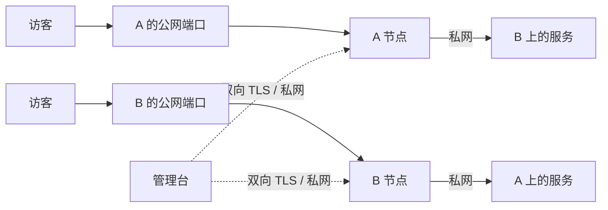

# NetShare


用图形界面管理多台 VPS 之间的私网端口映射。服务运行在 A 上，可以从 B 的公网端口访问；反方向独立配置。公网入口做 DNAT 和私网 SNAT，后端回包仍经过原入口。

Go 编译为一个二进制，包含控制台、节点代理和前端资源。浏览器不依赖外部脚本或字体。

## 能管理什么

- TCP、UDP、TCP + UDP，单端口或等长端口范围。
- 映射的新增、修改、停用、删除，按入口、方向和状态查看。
- 机器在线情况、现有监听端口、网卡收发字节和规则版本。
- 从入口机器检查目标服务的私网路由与 TCP 连通性。
- 操作记录、配置导出，以及主动重新下发规则。
- 登录会话、CSRF 校验和 HTTPS 管理入口。

控制台通过双向 TLS 连接私网代理。每台代理只接收控制台证书，只允许预先配置的目标私网 IP，且仅修改自己创建的 `ip netshare` nftables 表。



## 先确认网络条件

节点代理运行在 Linux，需要 `nft`、`ip`、`ss` 和 IPv4 转发权限。建议 Ubuntu 24.04 或更新的常规发行版。控制台可在 Linux 部署，也可在 macOS 本地开发并管理能访问的代理。

| 设备 | 选择的构建包 |
| --- | --- |
| 常见 Intel / AMD VPS，`uname -m` 为 `x86_64` | `linux_amd64` |
| ARM VPS，`uname -m` 为 `aarch64` 或 `arm64` | `linux_arm64` |
| macOS 开发 | 本机执行 `go build .`；实际转发代理仍部署到 Linux |

两台机器必须能通过私网互通，且入口到目标的路由确实经过配置的私网网卡。目标服务需要监听目标私网地址或 `0.0.0.0`；只监听 `127.0.0.1` 的服务不能直接映射。

```bash
# 在每个节点执行，替换为对端私网 IP。
ip -4 route get 10.42.0.11
ping -c 3 10.42.0.11
ss -lntup
```

程序会保留 SSH 22 和清单中的 `reserved_ports`，并拒绝与本机公网监听或现有启用映射冲突的入口端口。如果控制台的 HTTPS 代理与节点部署在同机，给该节点保留 `80`、`443`。

现有 UFW、iptables、nftables 或云防火墙仍按原规则工作。NetShare 不会清空它们，也不会越过其他防火墙的 `FORWARD DROP`。需要允许具体公网端口，以及两节点之间的相关转发和代理控制端口。

## 构建与初始化

需要 Go 1.26 或更新版本。

```bash
go mod download
go test ./...
go build -trimpath -o netshare .
```

复制 [机器清单示例](deploy/nodes.example.json)，填写自己的地址、网卡和保留端口。示例中的 `192.0.2.0/24` 是文档地址，不能直接用于部署。节点 ID 只允许字母、数字、下划线和连字符。

```bash
cp deploy/nodes.example.json nodes.json
# 编辑 nodes.json 后执行。secrets 目录必须尚不存在。
./netshare init \
  --dir ./secrets \
  --nodes ./nodes.json \
  --domain netshare.example.com
```

`--listen` 默认 `127.0.0.1:18440`，只允许回环地址；对外访问交给 HTTPS 反向代理。`--agent-port` 默认 `31880`，仅绑定各节点的私网 IP。

初始化会生成一套互相匹配的凭据，所有目录为 `0700`、文件为 `0600`。已有目录会被拒绝，避免重跑初始化意外更换 CA 或密码。屏幕只输出文件位置，管理员密码写在 `secrets/controller/admin-password.txt`，用户名为 `admin`。

```text
secrets/
├── authority/               内部 CA 和 CA 私钥，只离线保存
├── controller/              控制台配置、客户端证书和首次密码
│   ├── controller.json
│   ├── ca.pem
│   ├── controller.pem
│   ├── controller-key.pem
│   └── admin-password.txt
├── agents/
│   ├── edge-a/              只部署到 edge-a
│   └── edge-b/              只部署到 edge-b
└── manifest.json            创建时间与证书到期时间
```

控制台配置只保存 bcrypt 密码摘要。首次密码文件只在初始化时生成；之后在管理台修改密码不会更新这份文件，请同步维护自己的密码库。生产部署无需向服务器复制 `admin-password.txt`，留在本机受限目录保管即可。

不要把 `secrets/`、CA 私钥、配置文件或真实机器清单提交到代码仓库。每个节点只接收自己的 `agents/<id>/` 文件；CA 私钥不需要上传到任何运行中的服务。单个控制台支持 2–32 台机器。

## 安装到 Linux

下面的命令针对 systemd 主机。先把二进制、对应配置目录和 `deploy/` 文件通过可信 SSH 连接传到目标机器，再以 root 安装。控制台和其中一个节点可以运行在同一台机器。

每台节点安装系统依赖：

```bash
apt-get update
apt-get install -y nftables iproute2
install -m 0755 ./netshare /usr/local/bin/netshare
```

在控制台主机创建专用用户，并安装控制台自己的四个文件。首次密码保留在本地密码库即可，无需传到服务器。

```bash
getent passwd netshare >/dev/null || useradd --system --home-dir /var/lib/netshare --shell /usr/sbin/nologin netshare
install -d -o netshare -g netshare -m 0700 /etc/netshare /var/lib/netshare
install -o netshare -g netshare -m 0600 ./secrets/controller/controller.json /etc/netshare/controller.json
install -o netshare -g netshare -m 0600 ./secrets/controller/ca.pem /etc/netshare/ca.pem
install -o netshare -g netshare -m 0600 ./secrets/controller/controller.pem /etc/netshare/controller.pem
install -o netshare -g netshare -m 0600 ./secrets/controller/controller-key.pem /etc/netshare/controller-key.pem
install -m 0644 ./deploy/netshare.service /etc/systemd/system/netshare.service
systemctl daemon-reload
```

在每个节点安装它自己的配置。下面以 `edge-a` 为例，在另一个节点改用对应 ID。

```bash
NODE_ID=edge-a
install -d -m 0700 /etc/netshare-agent /var/lib/netshare-agent
install -m 0600 "./secrets/agents/$NODE_ID/agent.json" /etc/netshare-agent/agent.json
install -m 0600 "./secrets/agents/$NODE_ID/ca.pem" /etc/netshare-agent/ca.pem
install -m 0600 "./secrets/agents/$NODE_ID/server.pem" /etc/netshare-agent/server.pem
install -m 0600 "./secrets/agents/$NODE_ID/server-key.pem" /etc/netshare-agent/server-key.pem
install -m 0644 ./deploy/netshare-agent.service /etc/systemd/system/netshare-agent.service
systemctl daemon-reload
systemctl enable --now netshare-agent
```

所有节点代理都在线后，再在控制台主机执行 `systemctl enable --now netshare`。首次启动会确认节点没有历史配置，再落下初始控制台状态；缺少控制台状态但节点已有历史版本时，会拒绝用空配置覆盖，需先恢复备份。控制台已有有效状态时，单台节点离线不会阻止进入管理台。

代理保留 `CAP_NET_ADMIN`，用于 nftables 和 IPv4 转发。systemd 只放开状态目录、`/etc/sysctl.d` 和 IPv4 sysctl 的必要写入。控制台使用无特权用户，只能写自己的配置和状态目录，修改密码时会原子更新 `/etc/netshare/controller.json`；它不能直接改系统防火墙。

## 开通 HTTPS

把管理台域名的 DNS 记录指向控制台主机。使用 [Caddy 配置模板](deploy/Caddyfile)，把 `netshare.example.com` 改成初始化时填写的域名。让公网 `80/tcp`、`443/tcp` 能到达 Caddy。

在全新主机上安装 Caddy 后，可以把修改后的模板安装为 `/etc/caddy/Caddyfile`；已有站点则将这一个站点块并入现有配置，先备份原文件。

```bash
install -d -o caddy -g caddy -m 0750 /var/log/caddy
caddy validate --config /etc/caddy/Caddyfile
systemctl reload caddy
```

通过 `https://你的管理台域名` 登录。公网不需要开放 `18440`；控制台 HTTP 只监听回环。私网代理 `31880` 不向公网监听，且没有有效的控制台客户端证书就无法调用。

## 创建第一条映射

例如服务在 B 的 `10.42.0.11:8080`，想从 A 的公网 `18080` 访问：

1. 在「映射」中点击「新建映射」。
2. 入口选择 A，入口端口填 `18080`；目标选择 B，目标端口填 `8080`。
3. 选择 TCP 并保存，确认规则已应用。
4. 点目标检测，确认入口能通过私网连到目标 TCP 端口。
5. 从第三台机器访问 `http://A的公网IP:18080`，验证真正的公网入口。

反方向另建一条映射，选择 B 为入口、A 为目标。每个方向有各自端口归属，不会自动将整台机器的所有端口交给对方。

端口范围按顺序一一对应，例如 `18080-18089` 到 `8080-8089`。入口与目标范围的长度必须相等。

目标检测证明的是入口到目标的私网 TCP 连通；它不能代替公网防火墙、运营商网络或真实应用协议的测试。UDP 没有 TCP 式握手，必须发送服务能识别的数据，再确认真实响应。

## 运行语义

- 停用或删除映射会停止匹配的新连接。已经建立的连接由内核 conntrack 继续处理，通常会自然结束。
- 停控制台不会中断节点上的映射。停节点代理也不会自动删除已经写入内核的规则，仍可继续转发；代理重新启动会恢复持久化状态。
- 机器重启后，由 `netshare-agent.service` 启动并重新下发它保存的规则。
- 若运行环境改变导致恢复失败，例如入口端口被新服务占用，代理仍会提供受 mTLS 保护的管理接口，并在机器状态中显示恢复失败原因。修复冲突或停用对应映射后，可重新下发；配置文件损坏、证书无效或缺少系统命令则需先修复部署。
- 每台代理只管理 `table ip netshare`。现有 fail2ban、Docker 和其他防火墙的表不会被清空。
- 私网 SNAT 让后端看到入口节点的私网 IP。需要记录真实访客 IP 的网站，应另用支持转发头或 PROXY protocol 的应用层代理，并按真实应用配置可信入口。
- 只有两机器之间这一段走私网。访客到入口的公网流量仍受入口机器的套餐、带宽和计费规则约束。
- 当前工具管理 IPv4 入站映射，不改变机器默认出网 IP，也不迁移公网 IP。

## 日常维护

```bash
# 控制台状态与日志。
systemctl status netshare --no-pager
journalctl -u netshare -n 100 --no-pager

# 每台节点的状态与日志。
systemctl status netshare-agent --no-pager
journalctl -u netshare-agent -n 100 --no-pager

# 只查看本工具的规则，不清空其他表。
nft list table ip netshare
sysctl net.ipv4.ip_forward
```

控制台状态保存在 `/var/lib/netshare/state.json`，节点状态保存在 `/var/lib/netshare-agent/state.json`。代理写入的转发持久配置是 `/etc/sysctl.d/90-netshare-agent.conf`，并在自己的状态中记录初始转发值。

内部 CA 有效期十年，控制台和节点证书有效期两年。首次生成时间与到期时间见 `manifest.json`。定期检查证书，至少在到期前一个月安排轮换：

```bash
openssl x509 -in /etc/netshare/controller.pem -noout -enddate
openssl x509 -in /etc/netshare-agent/server.pem -noout -enddate
```

轮换时先备份配置和状态，在新的私密目录生成整套凭据；保留原管理员密码摘要和映射状态，安排同一次维护窗口替换控制台及全部节点证书，重启服务后检查各节点上线。旧 CA 与新 CA 不互信，不能只替换单侧。不要覆盖旧包，验收完成后再按凭据保留策略处理旧私钥。

## 备份与恢复

控制台备份配置及状态；节点备份各自配置及状态。备份文件同样包含私钥，使用受限目录并做离机保护。

控制台主机：

```bash
umask 077
install -d -m 0700 /var/backups/netshare
systemctl stop netshare
tar -C / -czf "/var/backups/netshare/controller-$(date +%Y%m%d-%H%M%S).tar.gz" etc/netshare var/lib/netshare
systemctl start netshare
```

每台节点：

```bash
umask 077
install -d -m 0700 /var/backups/netshare
systemctl stop netshare-agent
tar -C / -czf "/var/backups/netshare/agent-$(date +%Y%m%d-%H%M%S).tar.gz" etc/netshare-agent var/lib/netshare-agent
systemctl start netshare-agent
```

恢复时先停止相应服务，解包到原路径，控制台目录重新确认归属 `netshare:netshare`、目录 `0700`、文件 `0600`，然后启动服务。代理必须恢复到相同节点，不能把 A 的配置和私钥放到 B。在界面检查两端状态后再使用「同步规则」。

更换二进制前保留上一版本，检查发行包的 `SHA256SUMS`，用同目录新文件原子替换 `/usr/local/bin/netshare`，再重启对应服务。升级失败时换回旧二进制并恢复本次升级前的状态备份。

## 卸载与回退

先在控制台停用或删除该入口上的全部映射，并确认变更已应用。之后在相应主机停止服务：

```bash
systemctl disable --now netshare-agent
# 确认只针对 NetShare 的独立表操作。
nft delete table ip netshare
rm -f /etc/sysctl.d/90-netshare-agent.conf
rm -f /etc/systemd/system/netshare-agent.service
systemctl daemon-reload
```

删除此表会停止新的映射连接，已有 conntrack 会话仍可能存活。需要立即切断某条连接时，按该映射的原始公网地址、协议、端口精确清理连接跟踪；不要清空整机连接表。

根据节点状态里保存的 `original_forwarding` 决定是否恢复 `net.ipv4.ip_forward`。若 Docker、VPN 或其他服务已经在使用转发，不要直接将其设为 `0`。删掉本工具的 sysctl 文件不会自动重置当前内核值。

控制台卸载：

```bash
systemctl disable --now netshare
rm -f /etc/systemd/system/netshare.service
systemctl daemon-reload
```

配置和状态默认保留，便于重新安装。确认不再需要后，再单独处理 `/etc/netshare`、`/var/lib/netshare`、`/etc/netshare-agent`、`/var/lib/netshare-agent` 和离线凭据。控制台与代理共用一个二进制，只有两个角色都卸载后才删除 `/usr/local/bin/netshare`。若移除域名入口，只删除 Caddy 中本服务的站点块，再验证并重新加载配置。

## 开发与发行包

前端位于 `frontend/`，使用 React、TypeScript、Vite、Radix 和 TanStack Table，界面参考 Shadcn Admin。构建需要 Node.js 22.12+ 与 npm，Go 版本要求见 `go.mod`。线上只运行 Go 二进制，无需 Node 服务或外部 CDN。

```bash
npm --prefix frontend ci
npm --prefix frontend run build
go test -race ./...
go vet ./...
VERSION=v1.1.0 bash ./build.sh
```

`build.sh` 会按锁文件安装并重建前端，将全部静态资源编译进 Go 程序；先编译前端再运行 Go 测试，才能验证本次的真实资源。前端源文件变更后不要只运行 `go build`，否则会带上旧的静态页面。

本地界面开发可运行 `npm --prefix frontend run dev`。开发服务器只绑定回环地址，API 接口需连接自己的本地控制器，不要把生产凭据放入 Vite 环境变量。页面使用哈希路由，`/#mappings`、`/#nodes`、`/#events` 可直接访问。主题跟随系统，也可切换浅色或深色；浏览器只保存主题、侧栏和自动刷新偏好，登录使用 HttpOnly 会话。

需要在无真实节点的环境中验收界面时，可显式启动隔离控制器：

```bash
NETSHARE_UI_ACCEPTANCE=1 \
NETSHARE_UI_ACCEPTANCE_PASSWORD_FILE=/tmp/netshare-ui-qa-password.txt \
go test ./internal/control -run '^TestUIAcceptanceServer$' -count=1 -v -timeout=30m
```

它只监听 `127.0.0.1:19111`，使用真实控制器 API、会话和临时状态，代理规则保存在内存中。账号为 `admin`，随机密码只写入指定的 0600 文件。结束时发送中断信号，程序会关闭服务并删除密码文件；强制杀进程后需自行删除该文件。此模式验证界面交互，不代表真实网络路径已验通。

`dist/` 包含 Linux amd64、arm64 的压缩包和校验和。每个包带有对应架构的 `netshare` 二进制、部署模板、本说明和第三方许可 `licenses/`。CI 只构建和测试，不自动发布 Release 或修改线上配置。

## 来源与使用范围

NetShare 来自双机私网共享公网入口的实际运维场景。作者：byjoey。[博客](https://joeyblog.net) · [YouTube](https://youtube.com/@joeyblog) · [Telegram 群](https://t.me/+ft-zI76oovgwNmRh)。

仅在自己拥有或获得授权的服务器与网络中部署。上线前确认服务商私网、带宽和流量规则。前端参考项目的版权与许可保留在 `frontend/licenses/`。Radix 组件的弹层定位和滚动锁使用运行时样式，因此 CSP 允许内联样式；脚本、网络请求和字体仍只允许同源资源。

本项目按 [MIT 协议](LICENSE) 提供，使用者负责自己的网络配置、服务暴露范围与备份。
