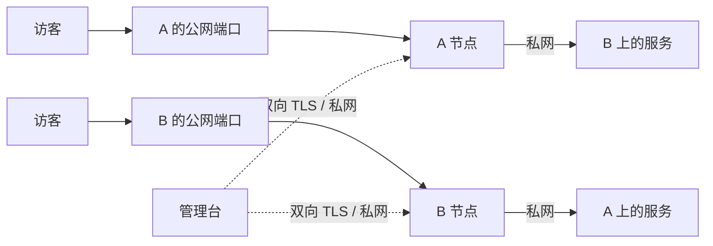

# NetShare

```bash
bash <(curl -fsSL https://github.com/byJoey/netshare/releases/latest/download/install.sh)
```

在控制台服务器上以 root 运行，选 `1 安装控制台`，端口直接回车默认 `18440`。脚本下载并校验 [最新发行版](https://github.com/byJoey/netshare/releases/latest)，自动生成密码、随机入口和节点证书，通过 `HTTP IP:端口` 打开空控制台。控制台同机选 `2 安装节点` 即可接入；其他机器用菜单 `13` 生成的一次性命令安装，无需编译、手写 JSON 或复制凭据包。支持 Linux amd64、arm64。


用图形界面管理多台 VPS 之间的私网端口映射。服务运行在 A 上，可以从 B 的公网端口访问；反方向独立配置。公网入口做 DNAT 和私网 SNAT，后端回包仍经过原入口。

Go 编译为一个二进制，包含控制台、节点代理和前端资源。浏览器不依赖外部脚本或字体。

## 安装与维护脚本

发行包自带 `manage.sh`，安装后可用 `netshare-manage` 菜单或子命令管理。支持安装控制台/节点、节点配对、升级、启停、日志、备份、卸载和更换随机入口；完整参数见 [安装管理说明](deploy/MANAGER.md)。脚本不修改云平台私网，也不覆盖现有网站。

新安装默认使用随机管理路径，首页、静态资源和 API 都位于该路径内。原根路径不会跳转到新入口。随机路径用于减少扫描和误访问，登录、会话和 CSRF 校验继续生效。显式执行 `netshare-manage entry` 可查看地址，`netshare-manage path rotate` 更换入口并检查新地址；旧入口会失效。

## 能管理什么

- TCP、UDP、TCP + UDP，单端口或等长端口范围。
- 映射的新增、修改、停用、删除，按入口、方向和状态查看。
- 机器在线情况、现有监听端口、网卡收发字节和规则版本。
- 从入口机器检查目标服务的私网路由与 TCP 连通性。
- 操作记录、配置导出，以及主动重新下发规则。
- 随机管理入口、登录会话与 CSRF 校验；支持自行配置 HTTPS 反向代理。

控制台通过双向 TLS 连接私网代理。每台代理只接收控制台证书，只允许预先配置的目标私网 IP，且仅修改自己创建的 `ip netshare` nftables 表。



## 先确认网络条件

节点代理运行在 Linux，需要 `nft`、`ip`、`ss` 和 IPv4 转发权限。建议 Ubuntu 24.04 或更新的常规发行版。控制台可在 Linux 部署，也可在 macOS 本地开发并管理能访问的代理。

| 设备 | 选择的构建包 |
| --- | --- |
| 常见 Intel / AMD VPS，`uname -m` 为 `x86_64` | `linux_amd64` |
| ARM VPS，`uname -m` 为 `aarch64` 或 `arm64` | `linux_arm64` |
| macOS 开发 | 本机执行 `go build .`；实际转发代理仍部署到 Linux |

两台机器必须能通过私网互通，且入口到目标的路由确实经过配置的私网网卡。目标服务需要监听目标私网地址或 `0.0.0.0`；只监听 `127.0.0.1` 的服务不能直接映射。

```bash
# 在每个节点执行，替换为对端私网 IP。
ip -4 route get 10.42.0.11
ping -c 3 10.42.0.11
ss -lntup
```

程序会保留 SSH 22 和清单中的 `reserved_ports`，并拒绝与本机公网监听或现有启用映射冲突的入口端口。控制台和节点同机时，不要把控制台端口用于业务映射。

现有 UFW、iptables、nftables 或云防火墙仍按原规则工作。NetShare 不会清空它们，也不会越过其他防火墙的 `FORWARD DROP`。需要允许具体公网端口，以及两节点之间的相关转发和代理控制端口。

## 一键安装

推荐在 Ubuntu 24.04 的 systemd 主机部署。默认用服务器 IP 加端口通过 HTTP 访问，无需域名。选择一个空闲管理端口，并在云防火墙和本机防火墙放行它，默认是 `18440/tcp`。需要 HTTPS 时可以[自行配置反向代理](#可选自行反代-https)。

### 1. 先装控制台

在控制台服务器以 root 运行顶部 Bash，选 `1 安装控制台`，首次只问管理端口，直接回车用 `18440`。脚本自动识别本机 IPv4，默认监听 `0.0.0.0:18440`。

脚本自动下载对应架构的正式包、校验 SHA256、生成一套内部 CA 和控制台凭据、随机管理员密码与管理路径。控制台先以空节点列表启动，不用等节点在线。

终端显示完整入口、用户名 `admin` 和首次密码。也可在服务器查看：

```bash
sudo netshare-manage entry
sudo cat /var/lib/netshare-bootstrap/controller/admin-password.txt
```

首次密码文件为 `0600`，在管理台改密码后不会自动更新它；请维护自己的密码库。CA 主私钥保存在 root 专用的 `/var/lib/netshare-bootstrap/authority/`，控制台进程无权读取。该目录用于后续签发节点凭据，要另做加密离机备份，不能放进代码仓库或公开网盘。

安装完成后访问 `entry` 给出的完整地址，例如 `http://服务器IP:18440/随机路径/`。只打开 `http://服务器IP:18440/` 返回 404 正常。NAT 主机需要将管理端口映射到外部。首次安装时改用下面的命令，用 `--host` 指定实际访问的公网 IPv4：

```bash
bash <(curl -fsSL https://github.com/byJoey/netshare/releases/latest/download/install.sh) install controller --port 18440 --host 192.0.2.10
```

自动识别不查询第三方 IP 服务。未找到本机全局 IPv4 时会采用默认路由网卡上的候选地址。访问地址参与 Origin 校验；已安装后需要改 NAT 公网地址时，修改 `/etc/netshare/controller.json` 的 `external_url` 为实际 `http://公网IP:端口`，保持随机路径、密码和状态不动，再执行 `sudo netshare-manage restart controller`。只换浏览器地址不会生效。

已有 `/etc/netshare/controller.json` 时，安装保留原监听、访问地址、密码、证书和映射，不重新问端口或生成 CA。

### 2. 安装控制台所在机器的节点

控制台安装完成后，在同一台机器运行 `sudo netshare-manage`，选 `2 安装节点`。向导会读取本机控制台和 CA，自动登记并安装本机节点；已登记的本机节点会复用现有身份，不重复添加。

能够确定的 IP 和网卡自动使用，多个候选或缺少私网信息时才询问。先用 `ip -br addr`、`ip -4 route get 对端私网IP` 核实地址与路由。没有配好的私网地址时，先在云平台和 Linux 内配通再继续；向导不会伪造网卡或恢复已关闭的私网。

### 3. 接入其他机器

在控制台服务器运行 `sudo netshare-manage`，选 `13` 添加远端节点。按提示填这台远端机器的 ID、名称、公网 IP、私网 IP、公网网卡和私网网卡；本机探测值不能当作远端信息。

控制台复用原 CA，生成对应节点的一次性安装命令。远端直接运行菜单 `2` 时，可以粘贴接入码；空输入或选择返回会先退出，不先装依赖或下载。把终端给出的完整命令复制到对应节点执行，安装器会自动领取并导入它自己的配置与叶子证书。命令形式如下，接入串必须用控制台实际生成的值：

```bash
bash <(curl -fsSL https://github.com/byJoey/netshare/releases/latest/download/install.sh) install agent --join '控制台生成的完整URL#KEY'
```

命令默认 15 分钟有效，首次领取后失效，包含的接入凭据要当密码保管。领取失败、用错接入串、已经使用或过期时，回到控制台菜单 `14` 为对应节点重新生成。若已领取成功、后续安装检查失败，终端会给出受限保存的安装包路径，可用 `--pairing` 重试，无需再领取。

### 4. 更新已有节点

添加新节点后，终端也会提供已有节点各自的更新命令。按节点逐台执行，让原代理的目标白名单包含新节点私网 IP；仅安装新节点可能造成单向不通。控制台同机的旧代理也要更新，可以再次选 `2` 就地导入当前配置；其他节点执行各自的更新命令。

更新保留代理状态和已有映射，只更换对应配置与叶子凭据。已有节点的 ID 或 CA 不匹配会被拒绝，不能互换 A、B 的命令或安装包。全部完成后，在控制台确认在线，再创建映射。

顶部命令需要 `curl`；在 Debian / Ubuntu 上，安装器会自动补齐 Python 3 及节点需要的 `nftables`、`iproute2`。其他发行版先自行安装 Python 3、`nft`、`ip`、`ss`。没有控制台资料或接入凭据时，向导先说明下一步，不会先安装依赖或下载发行包。

## 高级手动部署

下面用于离线部署、批量清单初始化或自行管理 CA 的场景。普通安装使用前面的一键流程即可；需要 HTTPS 也可在已有安装上自行反代。

### 离线配对包

无法从节点访问控制台时，也可手动传输控制台生成的对应配对包，再执行：

```bash
sudo netshare-manage install agent --pairing /root/netshare-node-edge-a.tar.gz
```

配对包只含该节点配置和叶子凭据，不含 CA 主私钥或管理员密码。每台节点只接收自己的包；旧节点需要更新目标白名单时也要导入本轮对应包。

### 构建与初始化

已下载发行包的用户可跳过源码构建，直接运行解压目录里的 `./netshare init` 准备凭据。只有从源码编译时需要 Go 1.26 或更新版本；重建界面另需 Node.js 22.12+。

```bash
go mod download
go test ./...
go build -trimpath -o netshare .
```

复制 [机器清单示例](deploy/nodes.example.json)，填写自己的地址、网卡和保留端口。示例中的 `192.0.2.0/24` 是文档地址，不能直接用于部署。节点 ID 只允许字母、数字、下划线和连字符。

```bash
cp deploy/nodes.example.json nodes.json
# 编辑 nodes.json 后执行。secrets 目录必须尚不存在。
./netshare init \
  --dir ./secrets \
  --nodes ./nodes.json \
  --domain netshare.example.com
```

上述 `init --nodes --domain` 手工方式默认监听 `127.0.0.1:18440`，配合自己的 HTTPS 反向代理。`--agent-port` 默认 `31880`，仅绑定各节点的私网 IP。

初始化会生成一套互相匹配的凭据，所有目录为 `0700`、文件为 `0600`。已有目录会被拒绝，避免重跑初始化意外更换 CA 或密码。屏幕只输出文件位置，管理员密码写在 `secrets/controller/admin-password.txt`，用户名为 `admin`。

```text
secrets/
├── authority/               内部 CA 和 CA 私钥，只离线保存
├── controller/              控制台配置、客户端证书和首次密码
│   ├── controller.json
│   ├── ca.pem
│   ├── controller.pem
│   ├── controller-key.pem
│   └── admin-password.txt
├── agents/
│   ├── edge-a/              只部署到 edge-a
│   └── edge-b/              只部署到 edge-b
└── manifest.json            创建时间与证书到期时间
```

控制台配置只保存 bcrypt 密码摘要。首次密码文件只在初始化时生成；之后在管理台修改密码不会更新这份文件，请同步维护自己的密码库。生产部署无需向服务器复制 `admin-password.txt`，留在本机受限目录保管即可。

不要把 `secrets/`、CA 私钥、配置文件或真实机器清单提交到代码仓库。每个节点只接收自己的 `agents/<id>/` 文件；离线初始化时，CA 私钥留在离线环境，不放到控制台进程可读的位置。批量清单初始化要求 2–32 台机器；一键安装允许先启动空控制台，再逐步添加，最多 32 台。

### 手动安装到 Linux

下面的命令针对 systemd 主机。先把二进制、对应配置目录和 `deploy/` 文件通过可信 SSH 连接传到目标机器，再以 root 安装。控制台和其中一个节点可以运行在同一台机器。

每台节点安装系统依赖：

```bash
apt-get update
apt-get install -y nftables iproute2
install -m 0755 ./netshare /usr/local/bin/netshare
```

在控制台主机创建专用用户，并安装控制台自己的四个文件。首次密码保留在本地密码库即可，无需传到服务器。

```bash
getent passwd netshare >/dev/null || useradd --system --home-dir /var/lib/netshare --shell /usr/sbin/nologin netshare
install -d -o netshare -g netshare -m 0700 /etc/netshare /var/lib/netshare
install -o netshare -g netshare -m 0600 ./secrets/controller/controller.json /etc/netshare/controller.json
install -o netshare -g netshare -m 0600 ./secrets/controller/ca.pem /etc/netshare/ca.pem
install -o netshare -g netshare -m 0600 ./secrets/controller/controller.pem /etc/netshare/controller.pem
install -o netshare -g netshare -m 0600 ./secrets/controller/controller-key.pem /etc/netshare/controller-key.pem
install -m 0644 ./deploy/netshare.service /etc/systemd/system/netshare.service
systemctl daemon-reload
```

在每个节点安装它自己的配置。下面以 `edge-a` 为例，在另一个节点改用对应 ID。

```bash
NODE_ID=edge-a
install -d -m 0700 /etc/netshare-agent /var/lib/netshare-agent
install -m 0600 "./secrets/agents/$NODE_ID/agent.json" /etc/netshare-agent/agent.json
install -m 0600 "./secrets/agents/$NODE_ID/ca.pem" /etc/netshare-agent/ca.pem
install -m 0600 "./secrets/agents/$NODE_ID/server.pem" /etc/netshare-agent/server.pem
install -m 0600 "./secrets/agents/$NODE_ID/server-key.pem" /etc/netshare-agent/server-key.pem
install -m 0644 ./deploy/netshare-agent.service /etc/systemd/system/netshare-agent.service
systemctl daemon-reload
systemctl enable --now netshare-agent
```

所有节点代理都在线后，再在控制台主机执行 `systemctl enable --now netshare`。首次启动会确认节点没有历史配置，再落下初始控制台状态；缺少控制台状态但节点已有历史版本时，会拒绝用空配置覆盖，需先恢复备份。控制台已有有效状态时，单台节点离线不会阻止进入管理台。

代理保留 `CAP_NET_ADMIN`，用于 nftables 和 IPv4 转发。systemd 只放开状态目录、`/etc/sysctl.d` 和 IPv4 sysctl 的必要写入。控制台使用无特权用户，只能写自己的配置和状态目录，修改密码时会原子更新 `/etc/netshare/controller.json`；它不能直接改系统防火墙。

### 可选：自行反代 HTTPS

需要 HTTPS 时，由自己安装 Caddy、Nginx 等反向代理。将管理域名解析到代理主机，修改 `/etc/netshare/controller.json`：`external_url` 填 `https://你的域名`，`cookie_secure` 设为 `true`；同机反代可将 `listen` 改回 `127.0.0.1:18440`，重启 `netshare`。转发整个站点，保留随机前缀。

使用 [Caddy 配置模板](deploy/Caddyfile)时，将 `netshare.example.com` 换成自己的域名。旧的 `init --nodes --domain` 手工初始化已经生成 HTTPS 访问配置，可直接使用。

在全新主机上安装 Caddy 后，可以把修改后的模板安装为 `/etc/caddy/Caddyfile`；已有站点则将这一个站点块并入现有配置，先备份原文件。

```bash
caddy validate --config /etc/caddy/Caddyfile
systemctl reload caddy
```

配置完成后执行 `sudo netshare-manage entry` 查看完整随机入口；手动部署时可用 `sudo /usr/local/bin/netshare access-path show --config /etc/netshare/controller.json` 查看。仅在已改回回环监听并由反代提供公网入口时，才无需对外开放控制台端口。节点的私网代理 `31880` 不向公网监听，且没有有效的控制台客户端证书就无法调用。

默认 Caddy 模板不启用访问日志，避免完整随机入口被写入请求记录。需要额外访问日志时，先配置路径脱敏。

## 创建第一条映射

例如服务在 B 的 `10.42.0.11:8080`，想从 A 的公网 `18080` 访问：

1. 在「映射」中点击「新建映射」。
2. 入口选择 A，入口端口填 `18080`；目标选择 B，目标端口填 `8080`。
3. 选择 TCP 并保存，确认规则已应用。
4. 点目标检测，确认入口能通过私网连到目标 TCP 端口。
5. 从第三台机器访问 `http://A的公网IP:18080`，验证真正的公网入口。

反方向另建一条映射，选择 B 为入口、A 为目标。每个方向有各自端口归属，不会自动将整台机器的所有端口交给对方。

端口范围按顺序一一对应，例如 `18080-18089` 到 `8080-8089`。入口与目标范围的长度必须相等。

目标检测证明的是入口到目标的私网 TCP 连通；它不能代替公网防火墙、运营商网络或真实应用协议的测试。UDP 没有 TCP 式握手，必须发送服务能识别的数据，再确认真实响应。

## 运行语义

- 停用或删除映射会停止匹配的新连接。已经建立的连接由内核 conntrack 继续处理，通常会自然结束。
- 停控制台不会中断节点上的映射。停节点代理也不会自动删除已经写入内核的规则，仍可继续转发；代理重新启动会恢复持久化状态。
- 机器重启后，由 `netshare-agent.service` 启动并重新下发它保存的规则。
- 若运行环境改变导致恢复失败，例如入口端口被新服务占用，代理仍会提供受 mTLS 保护的管理接口，并在机器状态中显示恢复失败原因。修复冲突或停用对应映射后，可重新下发；配置文件损坏、证书无效或缺少系统命令则需先修复部署。
- 每台代理只管理 `table ip netshare`。现有 fail2ban、Docker 和其他防火墙的表不会被清空。
- 私网 SNAT 让后端看到入口节点的私网 IP。需要记录真实访客 IP 的网站，应另用支持转发头或 PROXY protocol 的应用层代理，并按真实应用配置可信入口。
- 只有两机器之间这一段走私网。访客到入口的公网流量仍受入口机器的套餐、带宽和计费规则约束。
- 当前工具管理 IPv4 入站映射，不改变机器默认出网 IP，也不迁移公网 IP。

## 日常维护

```bash
# 控制台状态与日志。
systemctl status netshare --no-pager
journalctl -u netshare -n 100 --no-pager

# 每台节点的状态与日志。
systemctl status netshare-agent --no-pager
journalctl -u netshare-agent -n 100 --no-pager

# 只查看本工具的规则，不清空其他表。
nft list table ip netshare
sysctl net.ipv4.ip_forward
```

控制台状态保存在 `/var/lib/netshare/state.json`，节点状态保存在 `/var/lib/netshare-agent/state.json`。代理写入的转发持久配置是 `/etc/sysctl.d/90-netshare-agent.conf`，并在自己的状态中记录初始转发值。

内部 CA 有效期十年，控制台和节点证书有效期两年。首次生成时间与到期时间见 `manifest.json`。定期检查证书，至少在到期前一个月安排轮换：

```bash
openssl x509 -in /etc/netshare/controller.pem -noout -enddate
openssl x509 -in /etc/netshare-agent/server.pem -noout -enddate
```

轮换时先备份配置和状态，在新的私密目录生成整套凭据；保留原管理员密码摘要和映射状态，安排同一次维护窗口替换控制台及全部节点证书，重启服务后检查各节点上线。旧 CA 与新 CA 不互信，不能只替换单侧。不要覆盖旧包，验收完成后再按凭据保留策略处理旧私钥。

## 备份与恢复

在对应主机执行，备份保存在 `/var/backups/netshare/`：

```bash
sudo netshare-manage backup controller
sudo netshare-manage backup agent
```

控制台备份覆盖运行配置和状态，以及 `/var/lib/netshare-bootstrap` 内的 CA 与配对资料；代理备份自己的配置、状态和规则。自行配置的反向代理另做备份。备份含私钥，应在受限目录保存，并做加密离机保护。

管理脚本在安装、升级、节点添加、入口轮换和卸载前也会创建稳定快照；失败时自动恢复本次操作前的文件和原启停状态。备份命令自身不停机，需要跨文件同一时刻快照时，先停止相应角色。

手动恢复按快照中的 `manifest.json` 还原文件、uid/gid/mode；只恢复对应节点，不将 A 的凭据放到 B，不用旧状态覆盖后来新增的业务规则。详细方法见 [管理说明](deploy/MANAGER.md#备份与回退)。自行部署且没有管理脚本时，要一并备份自己的反向代理与离线 CA。

## 卸载与回退

```bash
sudo netshare-manage uninstall agent
sudo netshare-manage uninstall controller
```

在对应主机执行，默认停止并禁用指定服务、移除服务文件，保留配置、证书、状态、初始化资料和备份。自行配置的反向代理不受影响。

节点卸载只删除 `table ip netshare` 与 `/etc/sysctl.d/90-netshare-agent.conf`，不清空其他 nftables 表或整机 conntrack，也不直接将全局 IPv4 转发改回 `0`。删除规则会停止匹配的新连接，已有连接可能自然结束。

需要删除这个角色的数据时，显式加 `--purge`。控制台彻底清理包含 CA 主私钥和配对资料，先确认已经备份。所有快照始终保留。控制台与代理共用一个二进制，只有两个角色都卸载后才删除程序。详见 [卸载说明](deploy/MANAGER.md#卸载)。

## 开发与发行包

前端位于 `frontend/`，使用 React、TypeScript、Vite、Radix 和 TanStack Table，界面参考 Shadcn Admin。构建需要 Node.js 22.12+ 与 npm，Go 版本要求见 `go.mod`。线上只运行 Go 二进制，无需 Node 服务或外部 CDN。

```bash
npm --prefix frontend ci
npm --prefix frontend run build
go test -race ./...
go vet ./...
VERSION=v1.2.2 bash ./build.sh
```

`build.sh` 会按锁文件安装并重建前端，将全部静态资源编译进 Go 程序；先编译前端再运行 Go 测试，才能验证本次的真实资源。前端源文件变更后不要只运行 `go build`，否则会带上旧的静态页面。

本地界面开发可运行 `npm --prefix frontend run dev`。开发服务器只绑定回环地址，API 接口需连接自己的本地控制器，不要把生产凭据放入 Vite 环境变量。页面在管理入口后使用哈希路由；在入口地址后加 `#mappings`、`#nodes`、`#events` 可直接访问对应页面。主题跟随系统，也可切换浅色或深色；浏览器只保存主题、侧栏和自动刷新偏好，登录使用 HttpOnly 会话。

需要在无真实节点的环境中验收界面时，可显式启动隔离控制器：

```bash
NETSHARE_UI_ACCEPTANCE=1 \
NETSHARE_UI_ACCEPTANCE_PASSWORD_FILE=/tmp/netshare-ui-qa-password.txt \
go test ./internal/control -run '^TestUIAcceptanceServer$' -count=1 -v -timeout=30m
```

它只监听 `127.0.0.1:19111`，使用真实控制器 API、会话和临时状态，代理规则保存在内存中。账号为 `admin`，随机密码只写入指定的 0600 文件。结束时发送中断信号，程序会关闭服务并删除密码文件；强制杀进程后需自行删除该文件。此模式验证界面交互，不代表真实网络路径已验通。

`dist/` 包含 Linux amd64、arm64 的压缩包和校验和。每个包带有对应架构的 `netshare` 二进制、`manage.sh` 管理脚本、部署模板、本说明和第三方许可 `licenses/`。CI 只构建和测试，不自动发布 Release 或修改线上配置。

## 来源与使用范围

NetShare 来自双机私网共享公网入口的实际运维场景。作者：byjoey。[博客](https://joeyblog.net) · [YouTube](https://youtube.com/@joeyblog) · [Telegram 群](https://t.me/+ft-zI76oovgwNmRh)。

仅在自己拥有或获得授权的服务器与网络中部署。上线前确认服务商私网、带宽和流量规则。前端参考项目的版权与许可保留在 `frontend/licenses/`。Radix 组件的弹层定位和滚动锁使用运行时样式，因此 CSP 允许内联样式；脚本、网络请求和字体仍只允许同源资源。

本项目按 [MIT 协议](LICENSE) 提供，使用者负责自己的网络配置、服务暴露范围与备份。
